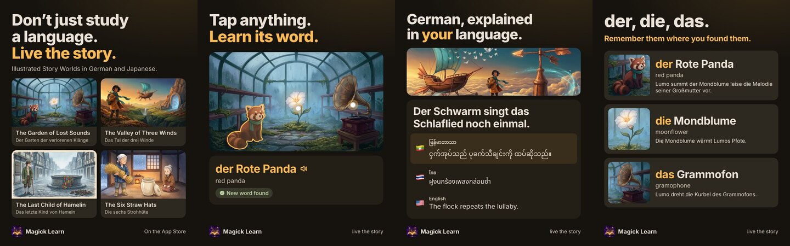

# Shipcast

**You shipped it. Now show it.**

Shipcast is a Claude Code plugin that turns a software product into social posts a team would
actually publish — images, carousels and videos for **Instagram, TikTok and LinkedIn**. It reads the
product's own code, docs or notes, designs every post from the real product (real screens, exact brand
colours, the product's own words), renders it, checks it, **looks at it**, and fixes it before you ever
see it.

By [Magick Studios](https://shipcast.magickstudios.ai) · [Website & guides](https://shipcast.magickstudios.ai) · MIT licensed



## Install

In Claude Code:

```
/plugin marketplace add General-Magick-Industries/shipcast
/plugin install shipcast@magick-studios
```

You also need **Node 22+**, **Google Chrome** (or Chromium/Edge), and **ffmpeg** for video
(`brew install ffmpeg` · `winget install ffmpeg` · `sudo apt install ffmpeg`).

## Use

Open Claude Code in your product's folder and ask:

```
/shipcast:create instagram-feed 3 focus on onboarding
```

Not inside the product's folder? Shipcast finds the products on your computer — code repos and doc
folders, most recently worked on first — and lets you pick one from a list.

Or just say it: *"make 3 Instagram posts about this app"*, *"a 15-second TikTok for our launch"*,
*"a LinkedIn carousel explaining how the sync works"*. Shipcast starts on its own.

It works with:

- **A codebase** — Flutter, Swift/SwiftUI, Kotlin/Compose, React Native/Expo, React, Next.js, Vue,
  Svelte, backends and CLIs. It reads design tokens, copy files, screens and pictures.
- **Docs or notes only** — a `docs/` folder, a `PRODUCT.md`, a pitch. If there's no brand yet, it
  proposes one and checks with you.
- **A description in chat** — for ideas that don't exist yet.

Results land in `shipcast-output/<date>-<product>-<format>/`: a PNG or MP4 per post, a contact sheet,
`captions.md` (captions, hashtags, alt text), and the `brief.md` it worked from.

## Formats

| Id | Size | Kind |
|---|---|---|
| `instagram-feed` | 1080×1350 (4:5) | image |
| `instagram-carousel` | 1080×1350 × 3–7 | carousel |
| `instagram-reel` | 1080×1920 (9:16), 15s | video |
| `tiktok-video` | 1080×1920 (9:16), 15s | video |
| `tiktok-photo` | 1080×1920 × 3–7 | carousel |
| `linkedin-image` | 1080×1350 (4:5) | image |
| `linkedin-square` | 1080×1080 (1:1) | image |
| `linkedin-video` | 1080×1350 (4:5), 20s | video |

Every format carries the platform's safe areas (where its buttons and captions sit), caption style and
hashtag limit.

## What makes it different from "make me some posts"

- **Grounded:** every feature and claim comes from the product, with evidence. No invented stats.
- **On-brand:** exact colours, fonts and the product's own design rules, read from the code.
- **Platform-correct:** exact sizes, safe areas, caption structure, hashtag limits.
- **Checked:** a layout check catches text that's cut off, off-frame or under the platform's buttons;
  then Claude looks at every render and fixes it.
- **Real video:** frame-accurate MP4s from CSS motion, with real screen recordings inside device
  frames — no screen-capture jitter.
- **Real app (optional):** capture the actual app from the iOS Simulator or an Android emulator.

## The toolkit

`skills/create/scripts/shipcast.mjs` — zero dependencies. Run it yourself if you like:

```
node skills/create/scripts/shipcast.mjs doctor
node skills/create/scripts/shipcast.mjs find
node skills/create/scripts/shipcast.mjs inventory ~/code/my-app
node skills/create/scripts/shipcast.mjs render post.html --format instagram-feed --out post.png
node skills/create/scripts/shipcast.mjs video reel.html --format instagram-reel --out reel.mp4
```

## Layout

```
.claude-plugin/        plugin.json + marketplace.json (this repo is its own marketplace)
skills/create/
  SKILL.md             the workflow
  references/          reading, brief, platforms, design, motion, review, real-app
  scripts/             shipcast.mjs + formats.json
```

## License

[MIT](LICENSE) © Magick Studios (General Magick Industries)
